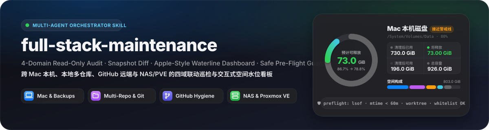
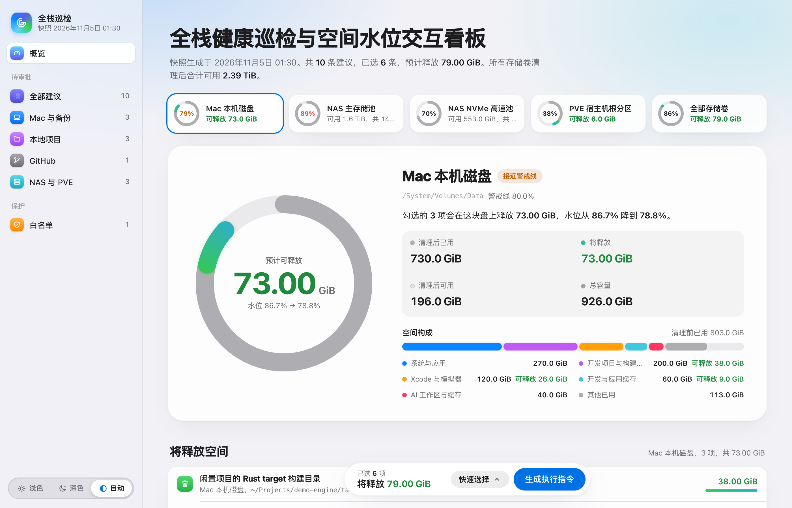
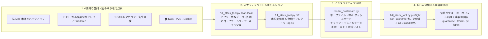

<div align="center">



<br/>

[](https://github.com/Sorasukiawa/full-stack-maintenance/actions/workflows/tests.yml)
[](LICENSE)
[-34d399.svg)](#-スクリプトの直接実行)
[](#-マルチエージェント対応とインストール)

**[English](README.md) · [简体中文](README.zh-CN.md) · [繁體中文](README.zh-TW.md) · [日本語](README.ja.md)**

</div>

---

**`full-stack-maintenance`** は、**macOS 本体とバックアップパイプライン**、**ローカルの複数リポジトリ・Worktree ワークスペース**、**GitHub アカウント全体のリモートリポジトリ**、**NAS / Proxmox VE / Docker ホームラボ**の 4 領域を並列・読み取り専用で一括点検するマルチエージェント統合メンテナンススキルです。前回ベースラインとの差分比較（`diff`）、**リアルタイム水位シミュレーターを備えた単一ファイル HTML ダッシュボード**の生成、そして承認後の実行直前に並行 AI セッションを保護する**事前安全チェック（`preflight`）**を提供します。

> [!NOTE]
> **外部依存ゼロ・厳格な安全ガードレール：** 同梱の Python 3.10+ スクリプト（`full_stack_tool.py` と `render_dashboard.py`）は標準ライブラリのみを使用し、証跡の収集・差分比較・ダッシュボード描画・実行前の並行安全性チェックのみを行います。**スクリプトが独断で `rm -rf` によるファイル削除、アプリのアンインストール、サービスの再起動、コンテナの破棄を行うことは一切ありません。** 唯一ファイルを移動するサブコマンド `quarantine` は `--ids` の明示指定が必須であり、`preflight` を通過したパスのみを復元可能な隔離領域バッチ（`manifest.json` と上書き防止機能付き `restore.sh` を自動生成）へ退避し、Git データ、Git worktree、ガバナンス文書、起動項目、ソフトウェア更新や周辺機器ファームウェアの助言項目はすべて拒否します。

---

## ✨ インタラクティブ HTML 水位シミュレーター・ダッシュボード

<div align="center">
  
</div>

点検ごとに外部依存ゼロ・macOS ネイティブアプリ風の単一ファイル `inspection-dashboard.html` を生成し、任意のスタンドアロンブラウザや制限付き IDE サンドボックスプレビューでそのまま操作できます：

- 🍎 **macOS アプリ風レイアウト** — すりガラス調のサイドバー、「システム設定」風のカラーアイコンタイル、太字の大型タイトル、インセットグループリスト、フローティングガラス操作ドックを備え、システムのライト／ダーク外観に自動追従（自動／ライト／ダークの手動切替にも対応）。
- 🎯 **ストレージリング概要（Apple「ヘルスケア」のアクティビティリング風）** — 丸端の太い単一リングで整理後の使用量（グレー）、選択項目の実質解放予定容量（`reclaimable_bytes` に基づくグリーン〜ティールの円弧グラデーションと柔らかい影。ファイルを直接削除しない最適化・更新項目の `reclaimable_bytes` は `0` として過剰計上を防止）、ホバー中項目の比率（ブルー）を描画し、中央に解放可能容量、右側に 4 マスの容量サマリーを表示。上部のミニリングで個別ボリュームと全体合計を切り替えられ（未マウントのプール `status: "unavailable"` はオフライン表示）、カプセル（ピル）型の「空間構成」バーで内訳を可視化します。
- 🪀 **軽いリバウンド付きのバネ物理アニメーション** — リング、数値遷移、セグメントコントロール、サイドバー選択、行の展開、エクスポートシートはすべて中断可能なスプリング物理（Apple の減衰比＋応答時間パラメータ）と事前計算された CSS `linear()` イージングで動作し、「視差効果を減らす」「透明度を下げる」「コントラストを上げる」アクセシビリティ設定を尊重します。
- 🎛️ **承認ワークベンチ＆アプリのデュアルモード・アンインストール** — 領域別ページ、リスク階層（A／B／C）グループ、アクション種別フィルタ（容量解放／構造整理／最適化／アップデート）を搭載。長期間未使用の Mac アプリはカード内で「**ユーザーデータを保持（`keep_data`、デフォルト：アプリ本体とキャッシュのみ移動）**」と「**関連データごと一括削除（`purge_all`、残存データを含む）**」を直接切り替えられ、上部のピル型水位バーにリアルタイム反映されます。
- 📈 **前回ベースラインとの差分比較（`diff`）** — 前回スナップショットと比較し、どのストレージボリュームが増加したか、どのディレクトリが急増したかを即座に特定します。
- ✏️ **サンドボックス対応 `localStorage` 状態保持＋項目別メモ** — チェック状態、アンインストールモード、項目ごとの微調整メモ（例：「最新 2 バージョンのみ残す」）はリロード後も保持され、`localStorage` が制限された `iframe` 内でも安全にフォールバックします。
- 🛡️ **永続ホワイトリスト（除外リスト）** — 任意の項目詳細から「加入白名单（ホワイトリストに追加）」を選ぶと除外ページへ移動し、エクスポート時に Git 管理外の `config/topology.local.json`（`whitelist.paths`、`whitelist.apps`、`whitelist.repos`、`whitelist.guest_ids`）へ反映できます。
- 📋 **実行プロンプトのワンクリック出力** — 選択した項目 ID、アンインストールモード（全体 `--uninstall-mode` および項目別の `id:keep-data` / `id:purge-all`）、微調整メモ、新規ホワイトリスト項目を構造化 Markdown 指示としてまとめ、AI エージェントへそのまま貼り付けられます。

---

## 🔄 4 段階アーキテクチャと安全実行ワークフロー



### 単一領域スキルとのオーケストレーション連携

単一領域の専門スキルを再実装するのではなく、インストール済みの各スキルと連携して領域横断の課題を解決します：

| 点検領域 | 連携する専門スキル / ツール | `full-stack-maintenance` が追加する領域横断機能 |
| :--- | :--- | :--- |
| **💻 Mac・アプリ・周辺機器** | [`mac-maintenance`](https://github.com/Sorasukiawa/mac-maintenance) | **全アプリの使用頻度・容量棚卸し＆デュアルモード削除**（デフォルト `keep_data` でユーザーデータを保持、`purge_all` は明示選択時のみ）；`~/Library` 配下 8 ディレクトリを横断する**アンインストール済みアプリの孤立残存データ集約**；**リンク切れ／クラッシュループ中の起動項目（LaunchAgents / LaunchDaemons）点検**；**Mac アプリ・開発環境の更新確認**；**内蔵／外付けストレージやドック・キーボード／マウスのファームウェア・SMART・USB 2.0（`480 Mb/s`）速度低下・低バッテリー点検**；**グローバル純粋キャッシュ走査**；**バックアップ除外漏れ検知**と APFS ローカルスナップショット拘束の調査 |
| **📂 ローカル複数リポジトリ＆AI** | [`repo-cleanup`](https://github.com/Sorasukiawa/repo-cleanup) · [`codex-maintenance`](https://github.com/Sorasukiawa/codex-maintenance) | ワークスペース全体のビルドキャッシュと `.git/objects/pack` 肥大化スキャン、ホスト横断の `git worktree list` 棚卸し（`~/orca/workspaces/` 等を含む。退役処理は `repo-cleanup` に委譲）、および `AGENTS.md` / `CLAUDE.md` のマージ前チェック宣言（`合入前检查：`）検証 |
| **🐙 GitHub リモート全体** | `gh repo list` · `gh run list` | 全公開／非公開リポジトリの棚卸し、古い `checkpoints/*` ブランチの検出、CI 失敗原因の切り分け（一時的なフレーク vs 実際の破損）、アーカイブ候補リポジトリの抽出 |
| **🏠 NAS・ホームラボ** | 読み取り専用 SSH・SMB マウント | Proxmox `/boot/efi` の旧カーネル逼迫、`local-lvm` の未接続孤立ボリュームと停止中の DR 演習クローン、LXC `pct fstrim`、Docker ビルドキャッシュとコンテナ健全性（`unhealthy`／再起動ループ）、NAS SMB `#recycle` ごみ箱による容量拘束の点検 |

---

## 🚀 マルチエージェント対応とインストール

汎用 [Agent Skills 仕様](https://agentskills.io) に準拠し、**Claude Code プラグインマニフェスト**（`.claude-plugin/`）と **OpenAI Codex UI マニフェスト**（`agents/openai.yaml`）を標準同梱しています（詳細は [マルチエージェント適応ガイド](references/multi-agent-hosts.md) を参照）：

| エージェントホスト | 呼び出し方法 | サブエージェントとダッシュボードの動作 |
| :--- | :--- | :--- |
| **Claude Code** | `/full-stack-maintenance` | `allowed-tools` により読み取り専用スキャンを事前承認；4 つの並列 `Agent` サブエージェントを起動；`$SKILL_ROOT/state/inspection-dashboard.html` に出力 |
| **OpenAI Codex** | `$full-stack-maintenance` | `agents/openai.yaml` の UI カードと既定プロンプトを読込；並列サブエージェントと `$SKILL_ROOT/state/inspection-dashboard.html` のプレビューに対応 |
| **Google Antigravity** | 自然言語または `$full-stack-maintenance` | 4 つの並列 `invoke_subagent` を起動（集計後に `manage_subagents` でメモリ解放）；HTML ダッシュボードは `$SKILL_ROOT/state/inspection-dashboard.html` に出力し `file://` リンクで参照（Artifact には Markdown レポートのみ出力） |
| **OpenCode** | `/full-stack-maintenance` または自然言語 | `task` ワーカーの並列実行または順次スキャンを実行し、`$SKILL_ROOT/state/` に単一 `.html` を出力 |
| **Cursor / Windsurf / Cline** | `@full-stack-maintenance` または自然言語 | サブエージェント非対応環境では自動的にメインセッションでの順次読み取り専用スキャンにフォールバック |

すべてのホストにおいて、スナップショット、差分、HTML ダッシュボード、`preflight`／`quarantine` の出力は Git 管理外の `$SKILL_ROOT/state/` に統一保存されます（Orca ワークスペース内では `orca-browser` で直接開くことも可能）。また、実行前のアクティブセッション・Worktree 保護は **Codex**（`~/.codex/sessions`）、**Claude Code**（`~/.claude/projects`）、**Antigravity**（`~/.gemini/antigravity-cli/brain`）、および **Orca** マルチ Worktree ディレクトリ（`~/orca/workspaces/`）を網羅します。

### 方法 1：Claude Code プラグインマーケットプレイス

```bash
claude plugin marketplace add Sorasukiawa/full-stack-maintenance
claude plugin install full-stack-maintenance@full-stack-maintenance
```

*（Claude Code セッション内では `/plugin marketplace add Sorasukiawa/full-stack-maintenance` と `/plugin install full-stack-maintenance@full-stack-maintenance` も実行可能です。）*

### 方法 2：汎用 `skills` CLI（Codex / Claude Code / Antigravity / Cursor / OpenCode）

[skills CLI](https://github.com/vercel-labs/skills) を使って各エージェントのグローバルスキルディレクトリへ導入できます：

```bash
# OpenAI Codex
npx skills add Sorasukiawa/full-stack-maintenance --skill full-stack-maintenance --agent codex --global

# Claude Code
npx skills add Sorasukiawa/full-stack-maintenance --skill full-stack-maintenance --agent claude-code --global

# 共通 ~/.agents/skills ディレクトリ（Antigravity / OpenCode / Cursor / Windsurf 共用）
npx skills add Sorasukiawa/full-stack-maintenance --skill full-stack-maintenance --global
```

### 方法 3：手動クローンによる導入

```bash
mkdir -p "$HOME/.agents/skills"
git clone https://github.com/Sorasukiawa/full-stack-maintenance.git "$HOME/.agents/skills/full-stack-maintenance"
```

---

## 🛡️ 6 つの「階層横断ストレージの罠」を検知・解決

> [!IMPORTANT]
> 「数十 GB 削除したのに空き容量が増えない」「クラウドバックアップがいつの間にか肥大化する」「ビルド成果物を消したら別セッションの AI 作業が壊れた」といったトラブルは、ストレージ階層をまたぐ連鎖反応が原因です。本スキルは以下の 6 つの罠を体系的に検知・対処します：

| # | 階層横断の罠 | 典型的な症状 | `full-stack-maintenance` の診断と解決策 |
| :-: | :--- | :--- | :--- |
| **1** | **バックアップ除外ルールの漏れ** | ビルド・保存用フォルダ（`*-builds`、`*-preservation`、`Artifacts`）の新規作成や改名により固定パスの除外設定をすり抜け、数十 GB のバイナリが iCloud や NAS へアップロードされる | `scan-local` が大型ビルドディレクトリと `backup_pipelines` の除外グロブ・スクリプト内容を照合し、バックアップ肥大化を事前に検知 |
| **2** | **APFS ローカルスナップショット拘束** | macOS で 50 GiB 以上のキャッシュを削除しても、`df -h` の空き容量が 1 GiB 未満しか増えない | `tmutil listlocalsnapshots /` を読み取り専用で確認し、ローカルバックアップを破棄する `tmutil thinlocalsnapshots` は C ランク候補としてユーザー承認後にのみ実行 |
| **3** | **iCloud 退避チャンクの再ダウンロード嵐** | iCloud Drive 上の退避済み（Evicted）暗号化バックアップチャンクに対して一括で `open()` やハッシュ検証を行い、数十 GB がローカル SSD に再ダウンロードされて逼迫する | 読み取り前に `st_blocks > 0` やクラウド常駐状態を確認し、`NSMetadataItem` 進捗照会をアップロード中のファイルに限定して再ダウンロード嵐と Spotlight IPC タイムアウトを防止 |
| **4** | **Proxmox LXC シンプールの未回収** | LXC コンテナ内で十数 GB の古いバックアップを削除してコンテナ内 `df -h` は下がったのに、ホスト側 `local-lvm` の `Data%` が高止まりする | PVE ホスト上の `pct fstrim <ctid>` を C ランク候補として提示し、未接続の `unused*` ボリュームや停止中の DR 演習クローンも C ランクとして棚卸し |
| **5** | **NAS SMB `#recycle` ごみ箱への滞留** | SMB マウント（`/Volumes/<共有名>`）経由で大容量アーカイブを削除しても、`#recycle` に移動するだけで Btrfs／NVMe プールの空きが増えない | `#recycle` の使用量を監査し、一括消去ではなく今回削除した該当エントリのみの直列削除を C ランク候補としてユーザー承認後に実行 |
| **6** | **アクティブ Git Worktree の連鎖保護＆外付けボリューム内での直接隔離** | 作業中の linked worktree 内の `target/` や `artifacts/` を消して並行 AI セッションを中断させたり、外付けドライブ上の大容量データをローカル隔離領域へ移動して内蔵 SSD を圧迫する | **48 時間保護ウィンドウ内でアクティブ**（Codex／Claude Code／Antigravity セッションおよび `~/orca/workspaces/` 対応）な linked worktree とその配下ディレクトリを丸ごと自動ブロック。外付けボリューム上の隔離対象は**その外付けボリューム自身の `.Trash-quarantine` ディレクトリ**へ直接移動し、内蔵システムディスクへのボリューム間コピーを一切行わない |

---

## 💻 スクリプトの直接実行

**Python 3.10+**（標準ライブラリのみ、`pip` パッケージ不要）で動作します。まずテンプレートを Git 管理外のローカル設定ファイルへコピーします：

```bash
cp -n config/topology.example.json config/topology.local.json
```

```bash
mkdir -p state

# 1. ローカル読み取り専用スキャンと前回ベースラインとの差分比較
python3 scripts/full_stack_tool.py scan-local \
  --config config/topology.local.json \
  --output state/current-snapshot.json --overwrite

python3 scripts/full_stack_tool.py diff \
  --before state/baseline-snapshot.json \
  --after state/current-snapshot.json \
  --output state/diff.json --overwrite

# 2. 単一ファイル・インタラクティブ HTML 水位ダッシュボードの描画
python3 scripts/render_dashboard.py \
  --input state/current-snapshot.json \
  --diff state/diff.json \
  --output state/inspection-dashboard.html --overwrite

# 3. 実行前の並行安全チェック（ホワイトリスト、シンボリックリンク、60分以内の変更、48時間アクティブ worktree 保護、lsof を検証）
python3 scripts/full_stack_tool.py preflight \
  --config config/topology.local.json \
  --targets state/current-snapshot.json \
  --ids "build-example-target,app-uninstall-example:keep-data" \
  --uninstall-mode keep-data \
  --output state/preflight.json --overwrite

# 4. 明示選択かつ preflight 通過済みの項目を復元可能な隔離領域へ移動（まずは --dry-run で計画を確認）
python3 scripts/full_stack_tool.py quarantine \
  --config config/topology.local.json \
  --targets state/current-snapshot.json \
  --ids "build-example-target,app-uninstall-example:keep-data" \
  --uninstall-mode keep-data \
  --dry-run \
  --output state/quarantine-plan.json --overwrite
```

JSON スキーマ全体および `preflight` ステータスコード（`SAFE_TO_EXECUTE`、`BLOCKED_WHITELISTED`、`BLOCKED_ACTIVE_WORKTREE`、`BLOCKED_RECENT_ACTIVITY`、`BLOCKED_OPEN_HANDLES`、`BLOCKED_DIRTY_WORKTREE`、`BLOCKED_SYMLINK_ROOT`）の詳細は [references/dashboard-and-cli.md](references/dashboard-and-cli.md) を参照してください。

---

## 📂 リポジトリ構成

| パス | 役割・内容 |
| :--- | :--- |
| [`SKILL.md`](SKILL.md) | メインスキル定義書：4 領域オーケストレーション、Fail-Closed ホワイトリスト、HTML ダッシュボード、`preflight`／`quarantine` 規則 |
| [`.claude-plugin/`](.claude-plugin/plugin.json) | Claude Code プラグインおよびマーケットプレイスマニフェスト |
| [`agents/openai.yaml`](agents/openai.yaml) | OpenAI Codex 向け表示名・概要・デフォルトプロンプト定義 |
| [`config/topology.example.json`](config/topology.example.json) | 匿名化済み設定テンプレート（ワークスペース、ストレージ水位、バックアップ、ホームラボ、ホワイトリスト） |
| [`scripts/full_stack_tool.py`](scripts/full_stack_tool.py) | 標準ライブラリのみの CLI（`scan-local`、`diff`、`preflight`、安全ガード付き `quarantine`） |
| [`scripts/render_dashboard.py`](scripts/render_dashboard.py) | 外部依存ゼロの単一ファイル HTML ダッシュボード生成スクリプト |
| [`references/domains-and-traps.md`](references/domains-and-traps.md) | 4 領域の詳細点検チェックリストと 6 つの階層横断ストレージ罠プレイブック |
| [`references/dashboard-and-cli.md`](references/dashboard-and-cli.md) | CLI 契約、JSON スキーマ、ステータスコード仕様 |
| [`references/multi-agent-hosts.md`](references/multi-agent-hosts.md) | Claude Code、Codex、Antigravity、OpenCode、Cursor、Orca 向けマルチエージェント適応ガイド |
| [`tests/`](tests/test_full_stack.py) · [`evals/`](evals/evals.json) | 分離フィクスチャ単体テスト（`test_full_stack.py`）、パッケージ検証（`check-skill.sh`）、トリガー／動作評価セット |

---

## 🧪 テストと検証

```bash
bash tests/check-skill.sh
python3 -B -m unittest discover -v -s tests
```

- `check-skill.sh` は YAML frontmatter、バージョン整合性（`SKILL.md`、`plugin.json`、`CHANGELOG.md`）、Markdown の相対リンク、JSON 構文、読み取り専用 `allowed-tools` 制約を検証し、`claude` CLI が利用可能な場合は `claude plugin validate --strict` も実行します。
- `test_full_stack.py` は一時ディレクトリ（`tempfile.TemporaryDirectory`）内の分離フィクスチャのみで全単体テストを実行し、実環境のシステムファイルには一切触れません。

---

## 🙏 クレジットとライセンス

以下のオープンソースプロジェクトの優れた設計思想に学びつつ、独自に設計・実装しています：
- **[SomSamantray/mac-storage-doctor](https://github.com/SomSamantray/mac-storage-doctor)** — 並列サブエージェント分割、`~/Library` と `/Applications` の残存データ突合、`.git` パック肥大化チェック
- **[jmagar/claude-homelab](https://github.com/jmagar/claude-homelab)** ＆ **[Sunwood-ai-labs/proxmox-skill](https://github.com/Sunwood-ai-labs/proxmox-skill)** — 外部化されたトポロジ設定、Proxmox VE／Docker コンテナ健全性チェック
- **[tw93/Mole](https://github.com/tw93/Mole)** ＆ **[fengyiqicoder/CleanMyMac](https://github.com/fengyiqicoder/CleanMyMac)** — 永続的な Fail-Closed ホワイトリストと整理後の実空き容量回収フロー

[MIT License](LICENSE) の下で公開されています © 2026 [Sorasukiawa](https://github.com/Sorasukiawa).
