<div align="center">


<br/>

[](https://github.com/Sorasukiawa/full-stack-maintenance/actions/workflows/tests.yml)
[](LICENSE)
[-34d399.svg)](#run-the-scripts-directly)
[](#multi-agent-support--install)

**[English](README.md) · [简体中文](README.zh-CN.md) · [繁體中文](README.zh-TW.md) · [日本語](README.ja.md)**

</div>

---

**`full-stack-maintenance`** is a multi-agent orchestrator skill that runs **4-domain parallel read-only health & storage audits** across **macOS**, **local multi-repository workspaces**, **GitHub repositories**, and **NAS / Proxmox VE / Docker homelabs**. It diffs current usage against your last baseline snapshot, renders a **zero-dependency interactive HTML waterline simulator dashboard**, and enforces a **pre-flight concurrency guard (`preflight`)** before executing any approved cleanup so concurrent AI coding sessions are never disrupted.

> [!NOTE]
> **Zero-Dependency & Strictly Read-Only Scripts:** The bundled Python 3.10+ scripts (`full_stack_tool.py` and `render_dashboard.py`) use only the Python standard library and never delete files, uninstall apps, or restart services on their own.

---

## ✨ Interactive HTML Waterline Dashboard

<div align="center">
  
</div>

Every audit generates a self-contained single-file `inspection-dashboard.html` that opens in any browser or IDE preview pane:

- 📊 **Live Storage Waterline Simulator** — Top storage gauges with red-line warning thresholds dynamically recalculate projected usage and reclaimed GiB as you check or uncheck candidate cards below.
- 📈 **Baseline Snapshot Diff Banner** — Automatically compares against your previous audit snapshot (`diff`) to spotlight which volumes grew and the top newly bloated directories.
- ✏️ **`localStorage` State & Per-Item Custom Notes** — Checkboxes and inline adjustment notes (e.g., *"keep latest 3 builds"*, *"move to NAS instead of deleting"*) persist across browser refreshes.
- 🛡️ **Persistent Exemption Whitelist** — One-click `🛡️ 长期豁免` collapses intentionally kept directories into a Whitelisted tab and exports them to your Git-ignored `config/topology.local.json`.
- 📋 **One-Click Execution Prompt Copy** — Packages your checked item IDs, per-item custom notes, and newly whitelisted paths into a structured Markdown instruction ready to paste back into your AI agent.

---

## 🔄 4-Stage Architecture & Workflow

```mermaid
flowchart LR
    subgraph S1["1. Parallel Read-Only Audit"]
        D1["💻 Mac & Backup Pipelines"]
        D2["📂 Local Workspaces & Git"]
        D3["🐙 GitHub Account Hygiene"]
        D4["🏠 NAS, Proxmox & Docker"]
    end

    subgraph S2["2. Snapshot & Diff Engine"]
        SCAN["full_stack_tool.py scan-local\nOrphans · .git Pack · Backup Drift"]
        DIFF["full_stack_tool.py diff\nWaterline Deltas & Growth Top 10"]
    end

    subgraph S3["3. Interactive Approval"]
        HTML["render_dashboard.py\nSingle-File HTML Board\nCheckboxes + Notes + Whitelist"]
    end

    subgraph S4["4. Guarded Execution & Reclaim"]
        PRE["full_stack_tool.py preflight\nlsof · mtime < 60m · Fail-Closed WL"]
        EXEC["Domain Cleanup + Physical Reclaim\ntmutil · pct fstrim · #recycle"]
    end

    S1 --> SCAN --> DIFF --> HTML --> PRE --> EXEC
```



### Orchestration with Single-Domain Skills

Instead of duplicating single-domain rules, `full-stack-maintenance` coordinates cleanly with specialized skills when installed:

| Domain | Coordinated Skill / Tool | Cross-Layer Capabilities Added by `full-stack-maintenance` |
| :--- | :--- | :--- |
| **💻 Mac & Backups** | [`mac-maintenance`](https://github.com/Sorasukiawa/mac-maintenance) | Cross-references `~/Library/{Application Support,Caches,Containers}` against installed `/Applications` `Info.plist` for **uninstalled app orphans**; detects **backup exclusion drift**; reclaims APFS local snapshots |
| **📂 Multi-Repo & AI** | [`repo-cleanup`](https://github.com/Sorasukiawa/repo-cleanup) · [`codex-maintenance`](https://github.com/Sorasukiawa/codex-maintenance) | Workspace-wide `.git/objects/pack` bloat scanner, multi-host worktree inventory (`.claude/worktrees`, `.worktrees`, Orca, Codex), and `AGENTS.md` pre-merge check verification |
| **🐙 GitHub Remote** | `gh repo list` · `gh run list` | Account-wide audit of public/private repos, stale `checkpoints/*` branches, CI failure root-cause triage (flake vs real regression), and repo archive candidates |
| **🏠 NAS & Homelab** | Read-only SSH & SMB mounts | Proxmox `/boot/efi` kernel bloat, `local-lvm` unused disks & test clones, LXC `pct fstrim`, Docker build cache & container health (`unhealthy` / restart loops), and NAS SMB `#recycle` capture |

---

## 🚀 Multi-Agent Support & Install

`full-stack-maintenance` is built on the universal [Agent Skills specification](https://agentskills.io) and includes native manifests for **Claude Code** (`.claude-plugin/`) and **OpenAI Codex** (`agents/openai.yaml`), working out of the box across major AI coding agents:

| Agent Host | Invocation | Subagent & Dashboard Adaptation |
| :--- | :--- | :--- |
| **Claude Code** | `/full-stack-maintenance` | Pre-approves read-only scans via `allowed-tools`; spawns 4 parallel `Task` subagents; opens or links local `.html` dashboard |
| **OpenAI Codex** | `$full-stack-maintenance` | Loads UI card from `agents/openai.yaml`; supports parallel subagents & local browser preview |
| **Google Antigravity** | Natural prompt or `$full-stack-maintenance` | Spawns 4 parallel `invoke_subagent` workers; renders dashboard directly as a clickable conversation Artifact |
| **OpenCode** | `/full-stack-maintenance` or natural prompt | Dispatches parallel `task` workers or sequential scan; outputs single-file `.html` |
| **Cursor / Windsurf / Cline** | `@full-stack-maintenance` or natural prompt | Automatically falls back to sequential multi-domain read-only scan when subagents are unavailable |

### Option 1: Claude Code Plugin Marketplace

```bash
claude plugin marketplace add Sorasukiawa/full-stack-maintenance
claude plugin install full-stack-maintenance@full-stack-maintenance
```

*(Inside a Claude Code session, you can also run `/plugin marketplace add Sorasukiawa/full-stack-maintenance` and `/plugin install full-stack-maintenance@full-stack-maintenance`.)*

### Option 2: Universal `skills` CLI (Codex, Claude Code, Antigravity, Cursor, OpenCode)

Use the [skills CLI](https://github.com/vercel-labs/skills) to install globally for your preferred agent:

```bash
# OpenAI Codex
npx skills add Sorasukiawa/full-stack-maintenance --skill full-stack-maintenance --agent codex --global

# Claude Code
npx skills add Sorasukiawa/full-stack-maintenance --skill full-stack-maintenance --agent claude-code --global

# Cursor / OpenCode / Antigravity (universal ~/.agents/skills)
npx skills add Sorasukiawa/full-stack-maintenance --skill full-stack-maintenance --global
```

### Option 3: Manual Clone / Shared Symlink

```bash
mkdir -p "$HOME/.agents/skills"
git clone https://github.com/Sorasukiawa/full-stack-maintenance.git "$HOME/.agents/skills/full-stack-maintenance"
```

---

## 🛡️ Five Cross-Layer Storage Traps Caught

> [!IMPORTANT]
> Deleting gigabytes of files often fails to free actual disk space—or silently re-uploads gigabytes to the cloud—because of cross-layer storage traps. `full-stack-maintenance` explicitly checks and resolves these five traps:

| # | Cross-Layer Trap | Typical Symptom | How `full-stack-maintenance` Solves It |
| :-: | :--- | :--- | :--- |
| **1** | **Backup Exclusion Drift** | Renaming or creating a new build/preservation folder (`*-builds`, `*-preservation`, `Artifacts`) bypasses hardcoded backup ignore lists and uploads tens of GBs to iCloud or NAS | `scan-local` cross-checks heavy project directories against `backup_pipelines` exclusion globs and script contents before they bloat remote backups |
| **2** | **APFS Local Snapshot Lock** | Deleting 50+ GiB of caches on macOS increases `df -h` free space by less than 1 GiB | Checks `tmutil listlocalsnapshots /` and reclaims locked blocks via `tmutil thinlocalsnapshots /System/Volumes/Data 100000000000 4` |
| **3** | **iCloud Dataless Re-Download Storm** | Running `open()` or hash verification across evicted iCloud backup chunks triggers `bird` to download tens of GBs back onto the local SSD | Inspects `st_blocks > 0` / ubiquitous download status before reading local chunks, and limits `NSMetadataItem` progress queries to active uploads |
| **4** | **Proxmox LXC Thin-Pool Lag** | Deleting files inside an LXC container lowers container `df -h`, but Proxmox `local-lvm` `Data%` stays near 85%+ | Follows guest cleanup with `pct fstrim <ctid>` on the PVE host and audits `unused*` volumes & stopped DR test clones |
| **5** | **NAS SMB `#recycle` Capture** | Deleting large archives over an SMB mount (`/Volumes/Data` or `/Volumes/Scratch`) moves them into `#recycle` without freeing Btrfs/NVMe pool space | Audits and purges `#recycle` directories across mounted NAS shares alongside primary cleanup |

---

## 💻 Run the Scripts Directly

Requires **Python 3.10+** (standard library only, zero `pip` packages). First copy the sanitized template to a Git-ignored local topology file:

```bash
cp -n config/topology.example.json config/topology.local.json
```

```bash
mkdir -p work/full-stack

# 1. Read-only local scan (orphans, .git pack bloat, build artifacts, backup exclusion drift)
python3 scripts/full_stack_tool.py scan-local \
  --config config/topology.local.json \
  --output work/full-stack/current-snapshot.json --overwrite

# 2. Diff against your previous baseline snapshot ("what grew since the last check")
python3 scripts/full_stack_tool.py diff \
  --before work/full-stack/baseline-snapshot.json \
  --after work/full-stack/current-snapshot.json \
  --output work/full-stack/diff.json --overwrite

# 3. Render the single-file interactive HTML waterline dashboard
python3 scripts/render_dashboard.py \
  --input work/full-stack/current-snapshot.json \
  --diff work/full-stack/diff.json \
  --output work/full-stack/inspection-dashboard.html --overwrite

# 4. Run pre-flight concurrency verification before executing checked items
python3 scripts/full_stack_tool.py preflight \
  --config config/topology.local.json \
  --targets work/full-stack/current-snapshot.json \
  --ids "build-example-target" \
  --output work/full-stack/preflight.json --overwrite
```

See [references/dashboard-and-cli.md](references/dashboard-and-cli.md) for the full JSON schema and `preflight` status codes (`SAFE_TO_EXECUTE`, `BLOCKED_WHITELISTED`, `BLOCKED_RECENT_ACTIVITY`, `BLOCKED_OPEN_HANDLES`, `BLOCKED_DIRTY_WORKTREE`, `BLOCKED_SYMLINK_ROOT`).

---

## 📂 Repository Layout

| Path | Purpose |
| :--- | :--- |
| [`SKILL.md`](SKILL.md) | Main skill playbook: 4-domain orchestration, fail-closed whitelist, HTML dashboard, and `preflight` rules |
| [`.claude-plugin/`](.claude-plugin/plugin.json) | Claude Code plugin and marketplace manifests |
| [`agents/openai.yaml`](agents/openai.yaml) | OpenAI Codex interface display name, summary, and default prompt |
| [`config/topology.example.json`](config/topology.example.json) | Sanitized template for workspace roots, storage gauges, backup pipelines, homelab hosts, and whitelist |
| [`scripts/full_stack_tool.py`](scripts/full_stack_tool.py) | Standard-library CLI for `scan-local`, `diff`, and `preflight` |
| [`scripts/render_dashboard.py`](scripts/render_dashboard.py) | Zero-dependency single-file interactive HTML dashboard generator |
| [`references/domains-and-traps.md`](references/domains-and-traps.md) | 4-domain audit checklist and the 5 cross-layer storage trap playbooks |
| [`references/dashboard-and-cli.md`](references/dashboard-and-cli.md) | CLI contract, JSON schemas, and status code definitions |
| [`references/multi-agent-hosts.md`](references/multi-agent-hosts.md) | Multi-agent adaptation guide for Claude Code, Codex, Antigravity, OpenCode, and Cursor |
| [`tests/`](tests/test_full_stack.py) · [`evals/`](evals/evals.json) | Isolated fixture unit tests (`test_full_stack.py`), package validator (`check-skill.sh`), and trigger/behavior evals |

---

## 🧪 Validation & Tests

```bash
bash tests/check-skill.sh
python3 -B -m unittest discover -v -s tests
```

- `check-skill.sh` validates YAML frontmatter, version alignment (`SKILL.md`, `plugin.json`, `CHANGELOG.md`), relative Markdown links, JSON schemas, read-only `allowed-tools` guards, and runs `claude plugin validate --strict` when the `claude` CLI is available.
- `test_full_stack.py` runs isolated temporary fixture tests covering fail-closed config validation, app orphan cross-referencing, `.git` pack bloat, backup exclusion drift, snapshot diffing, HTML dashboard rendering, and `preflight` concurrency blocking.

---

## 🙏 Design Credits & License

Inspired by open-source community projects and independently implemented:
- **[SomSamantray/mac-storage-doctor](https://github.com/SomSamantray/mac-storage-doctor)** — parallel subagent slicing, `~/Library` vs `/Applications` orphan cross-referencing, and `.git` pack bloat checks.
- **[jmagar/claude-homelab](https://github.com/jmagar/claude-homelab)** & **[Sunwood-ai-labs/proxmox-skill](https://github.com/Sunwood-ai-labs/proxmox-skill)** — externalized topology configuration and Proxmox VE / Docker health checks.
- **[tw93/Mole](https://github.com/tw93/Mole)** & **[fengyiqicoder/CleanMyMac](https://github.com/fengyiqicoder/CleanMyMac)** — persistent fail-closed whitelists and post-cleanup free-space reclamation.

Released under the [MIT License](LICENSE) © 2026 [Sorasukiawa](https://github.com/Sorasukiawa).
