<div align="center">


<br/>

[](https://github.com/Sorasukiawa/full-stack-maintenance/actions/workflows/tests.yml)
[](LICENSE)
[-34d399.svg)](#直接运行脚本)
[](#多-agent-适配与安装)

**[English](README.md) · [简体中文](README.zh-CN.md) · [繁體中文](README.zh-TW.md) · [日本語](README.ja.md)**

</div>

---

**`full-stack-maintenance`** 是面向主流 AI 编程助手的总管级全栈维护技能：支持跨 **Mac 本机与备份管线**、**本地多仓库工作区与 Worktree**、**GitHub 全账号远端仓库** 以及 **NAS / Proxmox VE / Docker 家庭服务器** 四大域执行并行只读巡检，自动对比上次巡检基线（「这几天是谁偷偷占了空间」），生成带**实时水位模拟器的单文件交互式 HTML 看板**，并在执行前强制运行**二次并发安全复查（`preflight`）**，保护正在并行工作的其他 AI 会话。

> [!NOTE]
> **零第三方依赖 · 脚本 100% 只读：** 附带的 Python 3.10+ 脚本（`full_stack_tool.py` 与 `render_dashboard.py`）仅使用标准库，只负责采集证据、基线对比、看板渲染与执行前并发安全校验，绝不自行删除文件、卸载软件或改动服务。

---

## ✨ 交互式 HTML 水位模拟看板预览

<div align="center">
  
</div>

每次巡检都会生成一份零外部依赖、采用 **Anthropic 社论暖黑／暖白设计语言** 的单文件 `inspection-dashboard.html`，可在任意独立浏览器或受限沙箱 IDE 预览面板中直接交互：

- 📊 **三层双色真实比例存储可视化系统** — 统一采用 `左侧：总容量 ｜ 中间进度条：[清理后已用][当前焦点项目（陶土橙 #D97757）][本池其他已选（鼠尾草绿 #52A37A）][原本空闲] ｜ 右侧：清理后已用（%）` 真实字节比例标尺，三层实时联动：
  1. **五池切换条与主存储池解剖条** — 覆盖 Mac 内置 APFS 宗卷、NAS 存储池与 PVE 虚拟化卷，勾选或悬停下方项目时以非线性轻回弹动画实时重算空间水位。
  2. **目录／类别分项微缩构成图** — 按 `~/Library`、`~/Codex`、`/private/var`、NAS 归档与 PVE 宿主机分组展示各目录清理前后的缩减比例。
  3. **每张卡片内嵌双色量级条** — 每张候选卡片内嵌所属存储池真实比例进度条，同时标出 `当前项目 -X GiB (%) ｜ 本池总清理 -Y GiB (%)`。
- 🌗 **暖曜石深色／暖白纸张浅色双主题 + 多维排序** — 默认启用低眩光暖曜石深色模式（`#141413`），支持一键切换浅色模式（`#FAF9F5`），并提供「默认顺序／按释放空间／按存储池」三种排序方式。
- 📈 **距上次巡检基线变化横幅** — 自动对比上一次快照（`diff`），直接标出各存储池涨跌与增长最快的 Top 目录。
- ✏️ **沙箱兼容 `localStorage` 记忆 + 单项微调备注框** — 刷新页面不丢失勾选状态（在禁用 `localStorage` 的沙箱 `iframe` 预览中自动安全降级）；每张卡片均可输入微调说明（如*「保留最近 2 个版本 / 移至归档目录」*）。
- 🛡️ **持久化豁免白名单** — 点击卡片上的 `加入白名单` 即可将该项移入白名单分页，并随指令一键同步回本地 `config/topology.local.json`，下次巡检不再反复打扰。
- 📋 **一键导出结构化执行指令** — 将勾选的条目 ID、手写的单项微调备注以及新增白名单一键打包成 Markdown 指令，粘贴回对话框即可驱动 Agent 安全执行。

---

## 🔄 四阶段全栈巡检与安全执行架构

```mermaid
flowchart LR
    subgraph S1["1. 四域并行只读巡检"]
        D1["💻 Mac 本机与备份管线"]
        D2["📂 本地项目群与 Worktree"]
        D3["🐙 GitHub 全账号远端"]
        D4["🏠 NAS · PVE · Docker"]
    end

    subgraph S2["2. 快照采集与基线对比"]
        SCAN["full_stack_tool.py scan-local\n孤儿残留 · .git 膨胀 · 备份穿透"]
        DIFF["full_stack_tool.py diff\n存储水位涨跌 & Top 增长路径"]
    end

    subgraph S3["3. 可视化交互审批"]
        HTML["render_dashboard.py\n单文件 HTML 水位看板\n勾选 + 微调备注 + 白名单"]
    end

    subgraph S4["4. 并发复核与物理释放"]
        PRE["full_stack_tool.py preflight\nlsof · mtime < 60m · 白名单拦截"]
        EXEC["分域执行 + 物理空间回收\ntmutil · pct fstrim · #recycle"]
    end

    S1 --> SCAN --> DIFF --> HTML --> PRE --> EXEC
```



### 与单域原子技能的编排联动

本技能不重复造轮子，而是作为总管编排联动已安装的专项维护技能：

| 巡检领域 | 联动复用的单域技能 / 工具 | `full-stack-maintenance` 补充的跨层能力 |
| :--- | :--- | :--- |
| **💻 Mac 与备份管线** | [`mac-maintenance`](https://github.com/Sorasukiawa/mac-maintenance) | 将 `~/Library/{Application Support,Caches,Containers}` 与已安装 `/Applications` 的 `Info.plist` 做**孤儿残留交叉比对**；检测**备份脚本漏排穿透**；回收 APFS 本地快照锁死空间 |
| **📂 本地多仓库与 AI** | [`repo-cleanup`](https://github.com/Sorasukiawa/repo-cleanup) · [`codex-maintenance`](https://github.com/Sorasukiawa/codex-maintenance) | 跨工作区批量扫描 `.git/objects/pack` 膨胀、汇总多宿主 Worktree（`.claude/worktrees`、`.worktrees`、Orca、Codex），并检查 `AGENTS.md` 合入前检查声明 |
| **🐙 GitHub 全账号远端** | `gh repo list` · `gh run list` | 全量盘点公开/私有仓库、清理 `checkpoints/*` 等陈旧分支、甄别 CI 失败真因（偶发竞态 vs 真实报错）、识别可归档仓库 |
| **🏠 NAS 与家庭服务器** | 只读 SSH 与挂载卷探针 | 检查 Proxmox `/boot/efi` 旧内核水位、`local-lvm` 未挂载孤儿盘与演练克隆机、LXC `pct fstrim`、Docker 构建缓存与容器健康度，以及 NAS SMB `#recycle` 二次截留 |

---

## 🚀 多 Agent 适配与安装

本技能遵循通用 [Agent Skills 规范](https://agentskills.io)，同时内置 **Claude Code 插件清单**（`.claude-plugin/`）与 **OpenAI Codex 界面清单**（`agents/openai.yaml`），开箱支持主流 Agent 宿主：

| Agent 宿主 | 调用方式 | 并行子代理与看板适配行为 |
| :--- | :--- | :--- |
| **Claude Code** | `/full-stack-maintenance` | 通过 `allowed-tools` 预授只读扫描权限（盘点不弹窗）；并行派发 4 个 `Task` 子代理；生成并打开本地 `.html` 看板 |
| **OpenAI Codex** | `$full-stack-maintenance` | 自动加载 `agents/openai.yaml` 卡片与默认提示词；支持并行子代理与本地浏览器预览 |
| **Google Antigravity** | 自然语言或 `$full-stack-maintenance` | 并行调用 4 路 `invoke_subagent` 分身；直接将交互式 HTML 看板输出为会话 Artifact |
| **OpenCode** | `/full-stack-maintenance` 或自然语言 | 调用 `task` 子代理或顺序执行四域只读扫描，生成单文件 `.html` 看板 |
| **Cursor / Windsurf / Cline** | `@full-stack-maintenance` 或自然语言 | 无子代理工具时自动回退为主会话分批只读扫描，体验完全一致 |

### 方式一：Claude Code 插件市场安装

```bash
claude plugin marketplace add Sorasukiawa/full-stack-maintenance
claude plugin install full-stack-maintenance@full-stack-maintenance
```

*（在 Claude Code 对话内也可直接输入 `/plugin marketplace add Sorasukiawa/full-stack-maintenance` 和 `/plugin install full-stack-maintenance@full-stack-maintenance`。）*

### 方式二：通用 `skills` CLI 安装（Codex / Claude Code / Antigravity / Cursor / OpenCode）

使用 [skills CLI](https://github.com/vercel-labs/skills) 一键安装到对应宿主的全局技能目录：

```bash
# OpenAI Codex
npx skills add Sorasukiawa/full-stack-maintenance --skill full-stack-maintenance --agent codex --global

# Claude Code
npx skills add Sorasukiawa/full-stack-maintenance --skill full-stack-maintenance --agent claude-code --global

# 通用 ~/.agents/skills 目录（Antigravity / OpenCode / Cursor / Windsurf 共用）
npx skills add Sorasukiawa/full-stack-maintenance --skill full-stack-maintenance --global
```

### 方式三：手动克隆安装

```bash
mkdir -p "$HOME/.agents/skills"
git clone https://github.com/Sorasukiawa/full-stack-maintenance.git "$HOME/.agents/skills/full-stack-maintenance"
```

---

## 🛡️ 专治五大「跨层存储陷阱」

> [!IMPORTANT]
> 很多时候「删了几十 GB 文件但磁盘可用空间没涨」或「云端备份莫名其妙被撑爆」，是因为跨层存储机制的连带效应。本技能内置了五大跨层陷阱的标准排查与回收闭环：

| # | 跨层陷阱 | 典型症状 | 本技能的根因诊断与回收方案 |
| :-: | :--- | :--- | :--- |
| **1** | **备份排除规则穿透** | 本地新建或改名了构建/归档目录（如 `*-builds`、`*-preservation`、`Artifacts`），穿透了备份脚本的死路径排除，把几十 GB 编译产物切片传上 iCloud 或 NAS | `scan-local` 自动对照 `backup_pipelines` 检查本地大型构建目录是否被排除通配符与脚本覆盖，提前拦截漏排 |
| **2** | **APFS 本地快照锁死** | 在 Mac 上删了 50+ GiB 缓存，`du` 确实少了，但 `df -h` 可用空间只涨了不到 1 GiB | 检查 `tmutil listlocalsnapshots /`，通过 `tmutil thinlocalsnapshots /System/Volumes/Data 100000000000 4` 立即释放被历史快照锁住的物理块 |
| **3** | **iCloud 占位分块回下风暴** | 对 iCloud Drive 下几十万个加密备份分块逐一运行解密校验，把原本已 Evict（仅在云端）的历史分块重新下载回本机塞爆磁盘 | 校验前先检查 `st_blocks > 0` 或云端驻留状态，且状态探针仅对正在上传的文件查进度，杜绝回下风暴与 Spotlight IPC 超时 |
| **4** | **PVE LXC 薄池未回收** | 在 LXC 容器内删掉十几个 GB 的旧备份，容器内 `df -h` 降了，但宿主机 `local-lvm` 的 `Data%` 分毫未动 | 容器内清理后在 PVE 宿主机执行 `pct fstrim <ctid>` 下发 Discard，并盘点 `unused*` 孤儿卷与停机演练克隆机 |
| **5** | **NAS SMB `#recycle` 截留** | 在 Mac 挂载的 `/Volumes/Data` 或 `/Volumes/Scratch` 上删掉几十 GB 文件，NAS 存储池可用空间完全没变 | 清理挂载卷时同步审计并清空各共享根目录下的 `#recycle` 回收站目录 |

---

## 💻 直接运行脚本

仅需 **Python 3.10+** 标准库（无需安装任何第三方包）。先将脱敏模板复制为 Git 忽略的个人配置文件：

```bash
cp -n config/topology.example.json config/topology.local.json
```

```bash
mkdir -p work/full-stack

# 1. 本机只读扫描（孤儿应用残留、.git Pack 膨胀、可重建构建产物、备份排除穿透检测）
python3 scripts/full_stack_tool.py scan-local \
  --config config/topology.local.json \
  --output work/full-stack/current-snapshot.json --overwrite

# 2. 与上次巡检基线对比（找出这几天是谁偷偷占了空间）
python3 scripts/full_stack_tool.py diff \
  --before work/full-stack/baseline-snapshot.json \
  --after work/full-stack/current-snapshot.json \
  --output work/full-stack/diff.json --overwrite

# 3. 渲染单文件交互式 HTML 水位模拟看板
python3 scripts/render_dashboard.py \
  --input work/full-stack/current-snapshot.json \
  --diff work/full-stack/diff.json \
  --output work/full-stack/inspection-dashboard.html --overwrite

# 4. 动手前二次并发安全复查（检查白名单、符号链接、60分钟内修改与 lsof 占用）
python3 scripts/full_stack_tool.py preflight \
  --config config/topology.local.json \
  --targets work/full-stack/current-snapshot.json \
  --ids "build-example-target" \
  --output work/full-stack/preflight.json --overwrite
```

完整 JSON 结构与 `preflight` 状态码说明见 [references/dashboard-and-cli.md](references/dashboard-and-cli.md)。

---

## 🧪 验证与测试

```bash
bash tests/check-skill.sh
python3 -B -m unittest discover -v -s tests
```

- `check-skill.sh` 检查 frontmatter、版本号一致性（`SKILL.md`、`plugin.json`、`CHANGELOG.md`）、Markdown 相对链接、JSON 语法、只读 `allowed-tools` 约束，并在安装了 `claude` CLI 时运行官方 `claude plugin validate --strict`。
- `test_full_stack.py` 在临时隔离目录（`tempfile.TemporaryDirectory`）中运行全部回归单测，绝不触碰真实系统文件。

---

## 🙏 设计参考与开源许可

本技能在实战全栈维护流程基础上，吸纳了以下开源项目的优秀设计思路并独立实现：
- **[SomSamantray/mac-storage-doctor](https://github.com/SomSamantray/mac-storage-doctor)**：并行子代理切片、`~/Library` 与 `/Applications` 孤儿残留交叉比对、Git Pack 膨胀检查；
- **[jmagar/claude-homelab](https://github.com/jmagar/claude-homelab)** 与 **[Sunwood-ai-labs/proxmox-skill](https://github.com/Sunwood-ai-labs/proxmox-skill)**：外置化环境拓扑配置、Proxmox VE 与 Docker 容器健康度深检；
- **[tw93/Mole](https://github.com/tw93/Mole)** 与 **[fengyiqicoder/CleanMyMac](https://github.com/fengyiqicoder/CleanMyMac)**：持久化 Fail-Closed 白名单保护与清理后物理空间回收闭环。

采用 [MIT License](LICENSE) 开源 © 2026 [Sorasukiawa](https://github.com/Sorasukiawa)。
