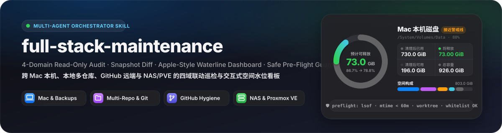
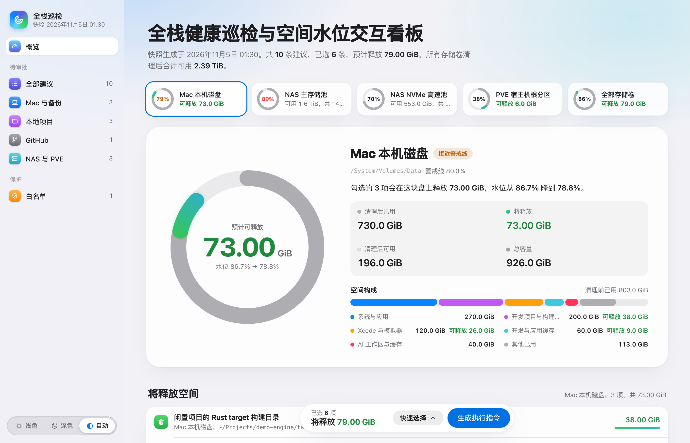
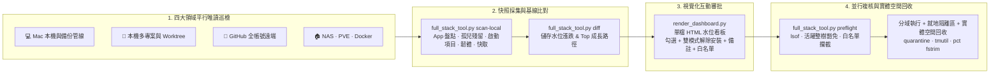

<div align="center">



<br/>

[](https://github.com/Sorasukiawa/full-stack-maintenance/actions/workflows/tests.yml)
[](LICENSE)
[-34d399.svg)](#-直接執行腳本)
[](#-多-agent-支援與安裝)

**[English](README.md) · [简体中文](README.zh-CN.md) · [繁體中文](README.zh-TW.md) · [日本語](README.ja.md)**

</div>

---

**`full-stack-maintenance`** 是專為主流 AI 程式開發助手打造的總管級全棧維護技能：支援跨 **Mac 本機與備份管線**、**本機多專案儲存庫（Repository）與 Worktree 工作區**、**GitHub 全帳號遠端儲存庫** 以及 **NAS / Proxmox VE / Docker 家用伺服器** 四大領域執行平行唯讀巡檢，自動比對上次巡檢基線（「找出這幾天是誰偷偷吃掉了儲存空間」），產生內建**即時水位模擬器的單檔互動式 HTML 看板**，並在執行清理前強制執行**二次並行安全複查（`preflight`）**，保護正在平行運作的其他 AI 開發對話。

> [!NOTE]
> **零第三方相依套件 · 嚴格安全護欄：** 內附的 Python 3.10+ 腳本（`full_stack_tool.py` 與 `render_dashboard.py`）僅使用標準函式庫，只負責證據採集、基線比對、看板渲染與執行前並行安全檢核，**絕不自行執行 `rm -rf` 刪除檔案、解除安裝軟體、重啟服務或銷毀容器**。唯一會移動檔案的子命令 `quarantine` 強制要求 `--ids` 明確指定項目，僅將通過 `preflight` 複查的路徑移入可還原的隔離區批次（自動附上 `manifest.json` 與防覆蓋 `restore.sh`），並一律拒絕搬移 Git 物件資料、Git worktree、治理文件、啟動項目、軟體更新與外接裝置韌體建議。

---

## ✨ 互動式 HTML 水位模擬看板預覽

<div align="center">
  
</div>

每次巡檢皆會產生一份零外部相依、採 macOS 原生應用程式風格設計的單檔 `inspection-dashboard.html`，可在任何獨立瀏覽器或受限沙箱 IDE 預覽面板中直接互動：

- 🍎 **macOS 應用式版面** — 毛玻璃側邊欄搭配「系統設定」風格的彩色圖示磚、粗體大標題、內嵌分組清單與懸浮玻璃操作列；預設跟隨系統淺色／深色外觀，亦可手動切換「自動／淺色／深色」。
- 🎯 **儲存空間圓環總覽（參考 Apple「健康」活動圓環設計）** — 單一圓頭粗環：灰色為清理後保留的已用空間，沿弧綠青漸層（附柔和圓頭陰影）為勾選項目預計實際釋放的儲存空間（依 `reclaimable_bytes` 計算，非刪除檔案的最佳化／更新建議計為 `0` 不虛增釋放量），藍色為游標懸停項目的佔比，圓心顯示可釋放容量，右側配四格容量統計。上方一排磁碟區小圓環可切換單一磁碟或全部磁碟區總計（未掛載磁碟區 `status: "unavailable"` 自動以離線狀態顯示），並以膠囊形分段「空間構成」條呈現磁碟佔用分佈。
- 🪀 **帶輕微回彈的彈簧物理動效** — 圓環、數字跳動、分段控制滑塊、側邊欄選取框、列表展開與匯出面板皆由可中斷的彈簧物理驅動（採用 Apple 阻尼比 + 響應時間參數），CSS 轉場使用預先計算的 `linear()` 彈簧曲線；完整遵循系統「減少動態效果」「降低透明度」「增加對比度」輔助使用設定。
- 🎛️ **審批工作台與雙模式應用程式解除安裝** — 依領域分頁、依風險等級（A／B／C）分組，並可依動作類型（空間清理／結構整理／效能最佳化／版本更新）篩選；久未使用的 Mac 應用程式支援在卡片內直接切換「**保留使用者資料（`keep_data`，預設僅移除 App 與快取）**」與「**一鍵完整清除（`purge_all`，含殘留檔案）**」；頂部膠囊形水位條即時預覽勾選對該磁碟區的影響。
- 📈 **距上次巡檢基線變化** — 自動比對前次快照（`diff`），標示各磁碟區水位漲跌與成長最快的 Top 目錄。
- ✏️ **沙箱相容 `localStorage` 狀態記憶 + 單項微調備註** — 重新整理頁面也不會遺失勾選狀態、解除安裝模式與備註（在停用 `localStorage` 的受限沙箱 `iframe` 預覽中自動安全降級）。
- 🛡️ **持久化豁免白名單** — 在任意建議明細點擊「加入白名單」即可移入白名單分頁，並隨匯出指令寫回本機 `config/topology.local.json`（涵蓋 `whitelist.paths`、`whitelist.apps`、`whitelist.repos`、`whitelist.guest_ids` 四類）。
- 📋 **一鍵匯出執行指令** — 將勾選的項目 ID、所選解除安裝模式（支援全域 `--uninstall-mode` 及逐項 `id:keep-data` / `id:purge-all`）、單項微調備註與新增白名單打包成結構化 Markdown 指令，直接貼回 AI 對話視窗。

---

## 🔄 四階段全棧巡檢與安全執行架構



### 與單一領域專項技能的編排聯動

本技能不重複造輪子，而是作為總管編排聯動已安裝的專項維護技能：

| 巡檢領域 | 聯動複用的專項技能 / 工具 | `full-stack-maintenance` 補充的跨層能力 |
| :--- | :--- | :--- |
| **💻 Mac、應用程式與外接裝置** | [`mac-maintenance`](https://github.com/Sorasukiawa/mac-maintenance) | **全量 App 使用頻率／體積盤點與雙模式解除安裝**（預設 `keep_data` 保留使用者資料；`purge_all` 含殘留一併移走須明確選擇）；跨 8 類 `~/Library` 目錄的**已移除應用孤兒殘留掃描與同源聚合**；**失效／崩潰啟動項目（LaunchAgents / LaunchDaemons）治理**；**軟體與開發環境更新巡檢**；**外接硬碟與周邊韌體／SMART／擴充座 USB 2.0 降速／鍵鼠低電量檢查**；**全域純快取掃描**；偵測**備份排除規則穿透**與排查 APFS 本機快照鎖死 |
| **📂 本機多儲存庫與 AI** | [`repo-cleanup`](https://github.com/Sorasukiawa/repo-cleanup) · [`codex-maintenance`](https://github.com/Sorasukiawa/codex-maintenance) | 跨工作區批次掃描可重建建置快取與 `.git/objects/pack` 物件膨脹、以 `git worktree list` 彙整各宿主 worktree（含 `~/orca/workspaces/`，退役交由 `repo-cleanup` 執行），並檢核 `AGENTS.md` / `CLAUDE.md` 的「`合入前检查：`」宣告 |
| **🐙 GitHub 全帳號遠端** | `gh repo list` · `gh run list` | 全量盤點公開／私有儲存庫、清理 `checkpoints/*` 等陳舊分支、判別 CI 失敗真因（偶發競態 vs 真實錯誤）、識別可封存（Archive）儲存庫 |
| **🏠 NAS 與家用伺服器** | 唯讀 SSH 與掛載磁碟區探針 | 唯讀檢查 Proxmox `/boot/efi` 舊核心水位、`local-lvm` 未掛載孤兒卷與停機演練複製機、LXC `pct fstrim`、Docker 建置快取與容器健康狀態（`unhealthy`／重啟循環），以及 NAS SMB `#recycle` 資源回收筒二次截留 |

---

## 🚀 多 Agent 支援與安裝

本技能遵循通用 [Agent Skills 規範](https://agentskills.io)，同時內建 **Claude Code 外掛資訊清單**（`.claude-plugin/`）與 **OpenAI Codex 介面設定**（`agents/openai.yaml`），開箱支援主流 AI 程式助手（詳見 [多 Agent 宿主適配指南](references/multi-agent-hosts.md)）：

| Agent 宿主 | 呼叫方式 | 平行子代理與看板適配行為 |
| :--- | :--- | :--- |
| **Claude Code** | `/full-stack-maintenance` | 透過 `allowed-tools` 預先授權唯讀掃描（盤點不跳確認視窗）；平行派發 4 個 `Agent` 子代理；看板統一輸出至 `$SKILL_ROOT/state/inspection-dashboard.html` |
| **OpenAI Codex** | `$full-stack-maintenance` | 自動載入 `agents/openai.yaml` 卡片與預設提示詞；支援平行子代理並開啟 `$SKILL_ROOT/state/inspection-dashboard.html` |
| **Google Antigravity** | 自然語言或 `$full-stack-maintenance` | 平行呼叫 4 路 `invoke_subagent`（彙整後以 `manage_subagents` 回收記憶體）；看板統一寫入 `$SKILL_ROOT/state/inspection-dashboard.html` 並以 `file://` 連結開啟（僅 Markdown 報告寫入對話 Artifact） |
| **OpenCode** | `/full-stack-maintenance` 或自然語言 | 呼叫 `task` 子代理或依序執行四域唯讀掃描，單檔 `.html` 看板輸出至 `$SKILL_ROOT/state/` |
| **Cursor / Windsurf / Cline** | `@full-stack-maintenance` 或自然語言 | 無子代理工具時自動降級為主對話分批唯讀掃描，體驗完全一致 |

所有宿主的快照、基線比對、HTML 看板與 `preflight`／`quarantine` 結果統一存放於技能目錄下被 Git 忽略的 `$SKILL_ROOT/state/`（在 Orca 終端機環境中可搭配 `orca-browser` 直接於內建瀏覽器面板開啟）。執行前的活躍對話與工作樹保護同時涵蓋 **Codex**（`~/.codex/sessions`）、**Claude Code**（`~/.claude/projects`）、**Antigravity**（`~/.gemini/antigravity-cli/brain`）以及 **Orca** 多工作樹目錄（`~/orca/workspaces/`）。

### 方式一：Claude Code 外掛市集安裝

```bash
claude plugin marketplace add Sorasukiawa/full-stack-maintenance
claude plugin install full-stack-maintenance@full-stack-maintenance
```

*（在 Claude Code 對話內亦可直接輸入 `/plugin marketplace add Sorasukiawa/full-stack-maintenance` 與 `/plugin install full-stack-maintenance@full-stack-maintenance`。）*

### 方式二：通用 `skills` CLI 安裝（Codex / Claude Code / Antigravity / Cursor / OpenCode）

使用 [skills CLI](https://github.com/vercel-labs/skills) 一鍵安裝至對應宿主的全域技能目錄：

```bash
# OpenAI Codex
npx skills add Sorasukiawa/full-stack-maintenance --skill full-stack-maintenance --agent codex --global

# Claude Code
npx skills add Sorasukiawa/full-stack-maintenance --skill full-stack-maintenance --agent claude-code --global

# 通用 ~/.agents/skills 目錄（Antigravity / OpenCode / Cursor / Windsurf 共用）
npx skills add Sorasukiawa/full-stack-maintenance --skill full-stack-maintenance --global
```

### 方式三：手動複製（Clone）安裝

```bash
mkdir -p "$HOME/.agents/skills"
git clone https://github.com/Sorasukiawa/full-stack-maintenance.git "$HOME/.agents/skills/full-stack-maintenance"
```

---

## 🛡️ 專治六大「跨層連帶儲存陷阱」

> [!IMPORTANT]
> 許多時候「刪了好幾十 GB 檔案但磁碟可用空間沒增加」「雲端備份莫名其妙被塞爆」或「清理建置產物卻中斷了隔壁正在跑的 AI 對話」，都是跨層儲存機制的連帶效應所致。本技能內建六大跨層陷阱的標準診斷與回收閉環：

| # | 跨層儲存陷阱 | 典型症狀 | 本技能的根因診斷與回收方案 |
| :-: | :--- | :--- | :--- |
| **1** | **備份排除規則穿透** | 在本機新增或重新命名建置／封存目錄（如 `*-builds`、`*-preservation`、`Artifacts`），穿透備份腳本寫死的排除清單，把數十 GB 編譯產物切塊上傳至 iCloud 或 NAS | `scan-local` 自動比對 `backup_pipelines` 檢查大型建置目錄是否被排除萬用字元與腳本涵蓋，提前攔截漏排 |
| **2** | **APFS 本機快照鎖死** | 在 Mac 上刪除了 50+ GiB 快取，`du` 統計確實減少，但 `df -h` 可用空間卻增加不到 1 GiB | 唯讀檢查 `tmutil listlocalsnapshots /`；因 `tmutil thinlocalsnapshots` 會捨棄本機備份時間點，列為 C 級候選待使用者確認後才執行 |
| **3** | **iCloud 雲端佔位檔回載風暴** | 對 iCloud Drive 下數十萬個加密備份分塊逐一開啟驗證雜湊，觸發系統將原本已釋出本機空間（Evicted）的歷史分塊重新下載回 SSD 塞爆磁碟 | 驗證前先檢查 `st_blocks > 0` 或雲端駐留狀態，且狀態探針僅對正在上傳的活躍檔案查詢進度，杜絕回載風暴與 Spotlight IPC 逾時 |
| **4** | **PVE LXC 精簡配置池未回收** | 在 LXC 容器內刪除十幾 GB 舊備份，容器內 `df -h` 下降了，但 Proxmox 宿主機 `local-lvm` 的 `Data%` 毫無變化 | 將 PVE 宿主機上的 `pct fstrim <ctid>` 列為 C 級候選待使用者確認，並一併盤點 `unused*` 未掛載孤兒卷與停機演練複製機（同為 C 級） |
| **5** | **NAS SMB `#recycle` 二次截留** | 透過 Mac 掛載的 `/Volumes/<NAS共用>` 刪除數十 GB 檔案，但 NAS Btrfs／NVMe 儲存集區可用空間完全沒變 | 稽核 `#recycle` 資源回收筒佔用；僅針對本批次刪除的項目列為 C 級候選待使用者確認後單執行緒清理，絕不整目錄清空 |
| **6** | **活躍 Git Worktree 級聯保護與外接碟就地隔離** | 清理活躍工作樹內的 `target/` 或 `artifacts/` 導致隔壁平行 AI 對話中斷；或將外接硬碟的大型封存檔移入本機隔離區，引發數十 GB 跨磁碟複製塞爆內建 SSD | **48 小時保護視窗內活躍**（涵蓋 Codex／Claude Code／Antigravity 對話與 `~/orca/workspaces/`）的 linked worktree 及其關聯目錄自動整樹攔截；外接磁碟區上的隔離檔案直接移入**該外接磁碟區自身的 `.Trash-quarantine` 目錄**，絕不跨卷拷回內建系統碟 |

---

## 💻 直接執行腳本

僅需 **Python 3.10+** 標準函式庫（無須安裝任何 `pip` 套件）。請先將去識別化範本複製為 Git 忽略的個人設定檔：

```bash
cp -n config/topology.example.json config/topology.local.json
```

```bash
mkdir -p state

# 1. 本機唯讀掃描，並與上次巡檢基線快照比對（找出近期空間成長來源）
python3 scripts/full_stack_tool.py scan-local \
  --config config/topology.local.json \
  --output state/current-snapshot.json --overwrite

python3 scripts/full_stack_tool.py diff \
  --before state/baseline-snapshot.json \
  --after state/current-snapshot.json \
  --output state/diff.json --overwrite

# 2. 渲染單檔互動式 HTML 水位模擬看板
python3 scripts/render_dashboard.py \
  --input state/current-snapshot.json \
  --diff state/diff.json \
  --output state/inspection-dashboard.html --overwrite

# 3. 動手前二次並行安全複查（檢查白名單、符號連結、60分鐘近期修改、48小時活躍 worktree 保護視窗與 lsof 佔用）
python3 scripts/full_stack_tool.py preflight \
  --config config/topology.local.json \
  --targets state/current-snapshot.json \
  --ids "build-example-target,app-uninstall-example:keep-data" \
  --uninstall-mode keep-data \
  --output state/preflight.json --overwrite

# 4. 將明確指定且通過複查的項目移入可還原隔離區（先以 --dry-run 預演計畫）
python3 scripts/full_stack_tool.py quarantine \
  --config config/topology.local.json \
  --targets state/current-snapshot.json \
  --ids "build-example-target,app-uninstall-example:keep-data" \
  --uninstall-mode keep-data \
  --dry-run \
  --output state/quarantine-plan.json --overwrite
```

完整 JSON 結構與 `preflight` 狀態碼（`SAFE_TO_EXECUTE`、`BLOCKED_WHITELISTED`、`BLOCKED_ACTIVE_WORKTREE`、`BLOCKED_RECENT_ACTIVITY`、`BLOCKED_OPEN_HANDLES`、`BLOCKED_DIRTY_WORKTREE`、`BLOCKED_SYMLINK_ROOT`）說明請參閱 [references/dashboard-and-cli.md](references/dashboard-and-cli.md)。

---

## 📂 專案目錄結構

| 路徑 | 用途說明 |
| :--- | :--- |
| [`SKILL.md`](SKILL.md) | 技能主入口與操作手冊：四域編排、Fail-Closed 白名單、HTML 看板與 `preflight`／`quarantine` 安全護欄 |
| [`.claude-plugin/`](.claude-plugin/plugin.json) | Claude Code 外掛與市集（Marketplace）資訊清單 |
| [`agents/openai.yaml`](agents/openai.yaml) | OpenAI Codex 技能卡片顯示名稱、摘要與預設提示詞 |
| [`config/topology.example.json`](config/topology.example.json) | 去識別化設定範本：工作區根目錄、儲存磁碟區水位、備份管線、家用伺服器與持久化白名單 |
| [`scripts/full_stack_tool.py`](scripts/full_stack_tool.py) | 零相依標準函式庫 CLI：`scan-local`、`diff`、`preflight` 與受控 `quarantine` |
| [`scripts/render_dashboard.py`](scripts/render_dashboard.py) | 零相依單檔互動式 HTML 水位模擬看板產生器 |
| [`references/domains-and-traps.md`](references/domains-and-traps.md) | 四大領域深度巡檢清單與六大跨層連帶儲存陷阱排查手冊 |
| [`references/dashboard-and-cli.md`](references/dashboard-and-cli.md) | CLI 參數契約、快照／比對／複核 JSON Schema 與狀態碼定義 |
| [`references/multi-agent-hosts.md`](references/multi-agent-hosts.md) | Claude Code、Codex、Antigravity、OpenCode、Cursor 與 Orca 多宿主適配指南 |
| [`tests/`](tests/test_full_stack.py) · [`evals/`](evals/evals.json) | 隔離臨時夾具單元測試（`test_full_stack.py`）、技能套件驗證腳本（`check-skill.sh`）與觸發評估集 |

---

## 🧪 驗證與測試

```bash
bash tests/check-skill.sh
python3 -B -m unittest discover -v -s tests
```

- `check-skill.sh` 會驗證 YAML frontmatter、版本號一致性（`SKILL.md`、`plugin.json`、`CHANGELOG.md`）、Markdown 相對連結、JSON 語法、唯讀 `allowed-tools` 限制，並在偵測到 `claude` CLI 時執行官方 `claude plugin validate --strict`。
- `test_full_stack.py` 於隔離的臨時目錄（`tempfile.TemporaryDirectory`）中執行所有回歸單元測試，涵蓋 Fail-Closed 設定檢核、孤兒殘留比對、`.git` 物件膨脹、備份排除規則穿透、基線快照比對、HTML 看板渲染與 `preflight`／`quarantine` 並行攔截，絕不觸碰真實系統檔案。

---

## 🙏 設計致謝與開源授權

本技能在實戰全棧維護流程基礎上，參考了以下開源專案的設計理念並獨立實作：
- **[SomSamantray/mac-storage-doctor](https://github.com/SomSamantray/mac-storage-doctor)**：平行子代理切分、`~/Library` 與 `/Applications` 孤兒殘留交叉比對、Git Pack 膨脹檢查；
- **[jmagar/claude-homelab](https://github.com/jmagar/claude-homelab)** 與 **[Sunwood-ai-labs/proxmox-skill](https://github.com/Sunwood-ai-labs/proxmox-skill)**：外部化環境拓撲設定、Proxmox VE 與 Docker 容器健康度檢查；
- **[tw93/Mole](https://github.com/tw93/Mole)** 與 **[fengyiqicoder/CleanMyMac](https://github.com/fengyiqicoder/CleanMyMac)**：持久化 Fail-Closed 白名單保護與清理後實體儲存空間回收閉環。

採用 [MIT License](LICENSE) 開源授權 © 2026 [Sorasukiawa](https://github.com/Sorasukiawa)。
