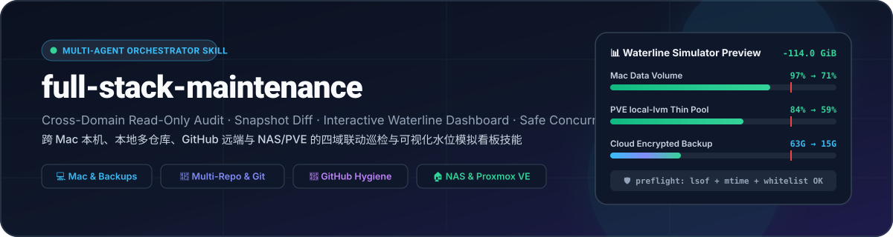
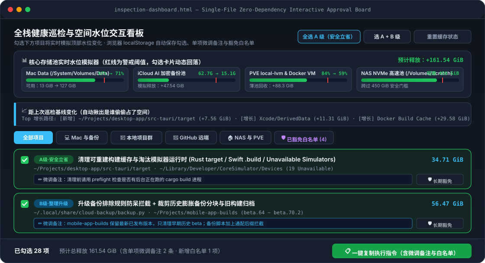

<div align="center">



<br/>

[](https://github.com/Sorasukiawa/full-stack-maintenance/actions/workflows/tests.yml)
[](LICENSE)
[-34d399.svg)](#直接執行腳本)
[](#多-agent-支援與安裝)

**[English](README.md) · [简体中文](README.zh-CN.md) · [繁體中文](README.zh-TW.md) · [日本語](README.ja.md)**

</div>

---

**`full-stack-maintenance`** 是面向主流 AI 程式助手的總管級全棧維護技能：支援跨 **Mac 本機與備份管線**、**本機多倉庫工作區與 Worktree**、**GitHub 全帳號遠端倉庫** 以及 **NAS / Proxmox VE / Docker 家庭伺服器** 四大領域執行平行唯讀巡檢，自動對比上次巡檢基線，產生帶**即時水位模擬器的單檔互動式 HTML 看板**，並在執行前強制執行**二次並行安全複查（`preflight`）**，保護正在同時運行的其他 AI 對話。

<div align="center">
  
</div>

---

## 🚀 多 Agent 支援與安裝

支援 **Claude Code、OpenAI Codex、Google Antigravity、OpenCode、Cursor、Windsurf** 等宿主（詳見 [多 Agent 宿主適配指南](references/multi-agent-hosts.md)）：

```bash
# Claude Code 外掛市集安裝
claude plugin marketplace add Sorasukiawa/full-stack-maintenance
claude plugin install full-stack-maintenance@full-stack-maintenance

# 通用 skills CLI 安裝（Codex / Claude Code / Antigravity / Cursor / OpenCode）
npx skills add Sorasukiawa/full-stack-maintenance --skill full-stack-maintenance --agent codex --global
npx skills add Sorasukiawa/full-stack-maintenance --skill full-stack-maintenance --agent claude-code --global
```

## 💻 直接執行腳本

```bash
cp -n config/topology.example.json config/topology.local.json
mkdir -p work/full-stack

python3 scripts/full_stack_tool.py scan-local --config config/topology.local.json --output work/full-stack/current-snapshot.json --overwrite
python3 scripts/full_stack_tool.py diff --before work/full-stack/baseline-snapshot.json --after work/full-stack/current-snapshot.json --output work/full-stack/diff.json --overwrite
python3 scripts/render_dashboard.py --input work/full-stack/current-snapshot.json --diff work/full-stack/diff.json --output work/full-stack/inspection-dashboard.html --overwrite
python3 scripts/full_stack_tool.py preflight --config config/topology.local.json --targets work/full-stack/current-snapshot.json --ids "build-example-target" --output work/full-stack/preflight.json --overwrite
```

## 🧪 驗證與測試

```bash
bash tests/check-skill.sh
python3 -B -m unittest discover -v -s tests
```

詳細說明請參閱 [簡體中文指南](README.zh-CN.md) 與 [English README](README.md)。採用 [MIT License](LICENSE) 授權 © 2026 [Sorasukiawa](https://github.com/Sorasukiawa)。
