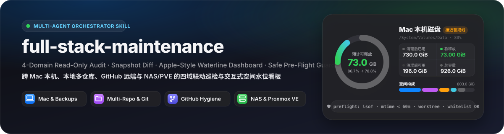

<div align="center">



<br/>

[](https://github.com/Sorasukiawa/full-stack-maintenance/actions/workflows/tests.yml)
[](LICENSE)
[-34d399.svg)](#直接執行腳本)
[](#多-agent-支援與安裝)

**[English](README.md) · [简体中文](README.zh-CN.md) · [繁體中文](README.zh-TW.md) · [日本語](README.ja.md)**

</div>

---

**`full-stack-maintenance`** 是面向主流 AI 程式助手的總管級全棧維護技能：支援跨 **Mac 本機與備份管線**、**本機多倉庫工作區與 Worktree**、**GitHub 全帳號遠端倉庫** 以及 **NAS / Proxmox VE / Docker 家庭伺服器** 四大領域執行平行唯讀巡檢，自動對比上次巡檢基線，產生帶**即時水位模擬器的單檔互動式 HTML 看板**，並在執行前強制執行**二次並行安全複查（`preflight`）**，保護正在同時運行的其他 AI 對話。

<div align="center">
  
</div>

每次巡檢都會產生一份零外部依賴、按 macOS 原生應用風格設計的單檔 `inspection-dashboard.html`，可在任意瀏覽器或受限沙箱 IDE 預覽面板中直接互動：

- 🍎 **macOS 應用式佈局** — 毛玻璃側欄配「系統設定」風格彩色圖示塊、加粗大標題、內嵌分組列表與懸浮玻璃操作欄；預設跟隨系統淺色／深色外觀，也可手動切換「自動／淺色／深色」。
- 🎯 **儲存圓環總覽（樣式參考 Apple 健康活動圓環）** — 一條圓頭粗環：灰色為清理後已用，沿弧綠青漸層（帶柔和圓頭陰影）為本次勾選將釋放的空間，藍色為懸停項佔比，圓心顯示可釋放大小，右側配四格容量數據。上方儲存卷小圓環可切換單碟或全部儲存卷，右側藥丸形分段「空間構成」條展示磁碟被什麼佔滿。
- 🪀 **帶輕回彈的彈簧動效** — 圓環、數字、分段控制滑塊、側欄選中塊、列展開與匯出面板皆由可打斷的彈簧驅動（採用 Apple 阻尼比 + 響應時間參數），CSS 過渡使用預先計算的 `linear()` 彈簧曲線；遵循系統「減少動態效果」「降低透明度」「增加對比度」設定。
- 🎛️ **勾選工作台與一鍵匯出** — 側欄依領域分頁、按風險等級（A／B／C）分組與動作類型篩選，頂部藥丸形水位條即時預覽影響；支援單項微調備註、持久化白名單（`config/topology.local.json`）與一鍵複製執行指令。

---

## 🚀 多 Agent 支援與安裝

支援 **Claude Code、OpenAI Codex、Google Antigravity、OpenCode、Cursor、Windsurf** 等宿主（詳見 [多 Agent 宿主適配指南](references/multi-agent-hosts.md)）：

```bash
# Claude Code 外掛市集安裝
claude plugin marketplace add Sorasukiawa/full-stack-maintenance
claude plugin install full-stack-maintenance@full-stack-maintenance

# 通用 skills CLI 安裝（Codex / Claude Code / Antigravity / Cursor / OpenCode）
npx skills add Sorasukiawa/full-stack-maintenance --skill full-stack-maintenance --agent codex --global
npx skills add Sorasukiawa/full-stack-maintenance --skill full-stack-maintenance --agent claude-code --global
```

## 💻 直接執行腳本

```bash
cp -n config/topology.example.json config/topology.local.json
mkdir -p state

python3 scripts/full_stack_tool.py scan-local --config config/topology.local.json --output state/current-snapshot.json --overwrite
python3 scripts/full_stack_tool.py diff --before state/baseline-snapshot.json --after state/current-snapshot.json --output state/diff.json --overwrite
python3 scripts/render_dashboard.py --input state/current-snapshot.json --diff state/diff.json --output state/inspection-dashboard.html --overwrite
python3 scripts/full_stack_tool.py preflight --config config/topology.local.json --targets state/current-snapshot.json --ids "build-example-target" --output state/preflight.json --overwrite
```

## 🧪 驗證與測試

```bash
bash tests/check-skill.sh
python3 -B -m unittest discover -v -s tests
```

詳細說明請參閱 [簡體中文指南](README.zh-CN.md) 與 [English README](README.md)。採用 [MIT License](LICENSE) 授權 © 2026 [Sorasukiawa](https://github.com/Sorasukiawa)。
